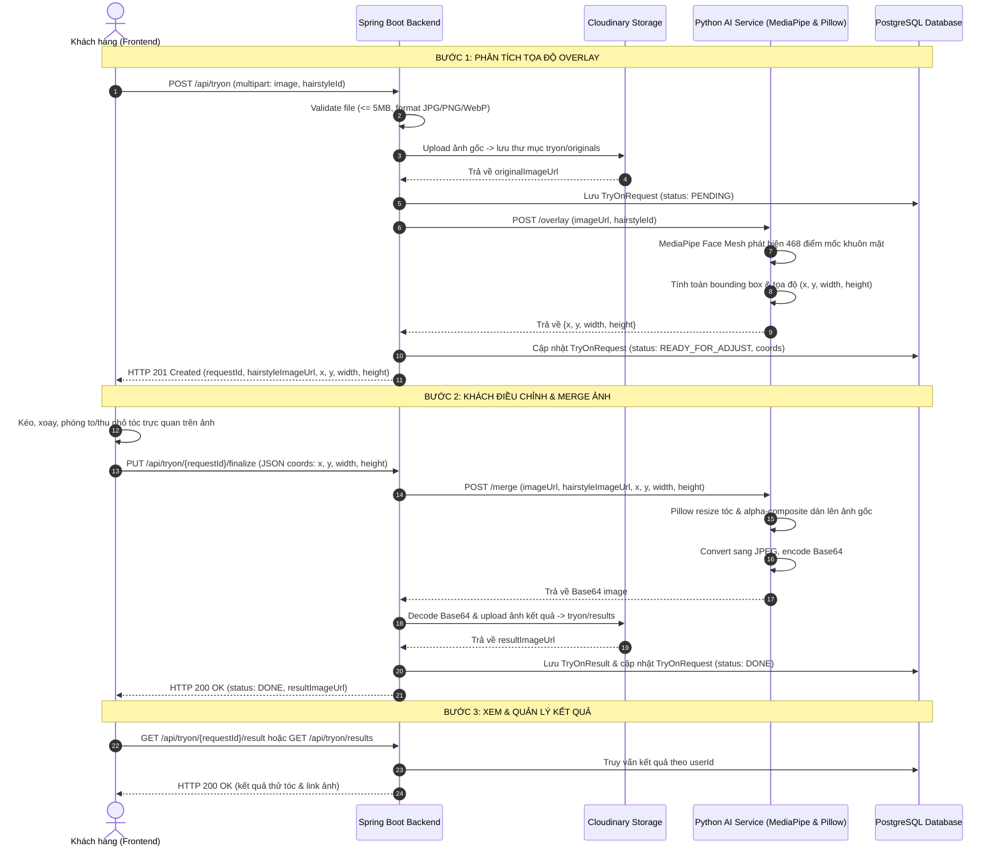
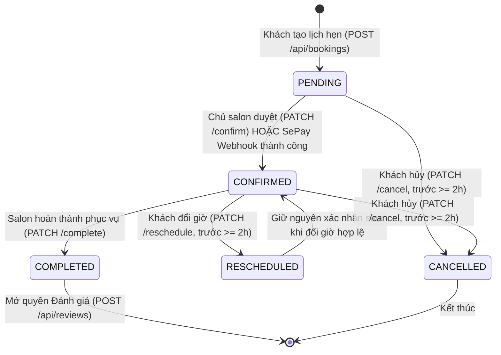
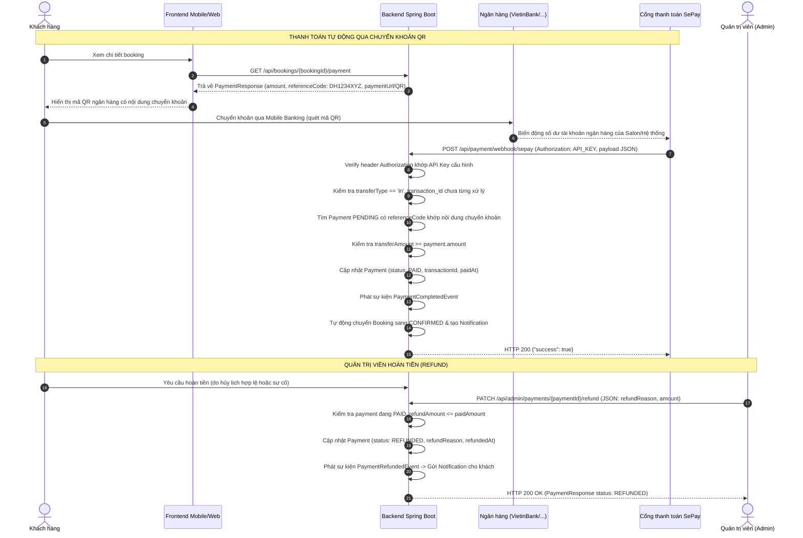

# Yêu cầu hiện trạng hệ thống

Tài liệu này mô tả hành vi đang có trong mã nguồn tại thời điểm 2026-10-02. Đây là tài liệu reverse-engineering, không phải yêu cầu thiết kế mới. Nguồn chính là controller, DTO, service, exception handler, security config, migration và `ai-tryon-service`.

## 1. Quy ước chung

### 1.1 Xác thực và phân quyền

- Backend stateless, dùng JWT Bearer. Mọi route cần JWT hợp lệ trừ các route public được nêu trong từng mục.
- Route public: `/api/auth/register`, `/api/auth/login`, `/api/auth/google`, `/api/auth/refresh`, `/api/auth/logout`, `/api/public/**`, `/api/payment/webhook/**`, Swagger và API docs.
- Role được kiểm tra bằng `@PreAuthorize`: `ADMIN`, `SALON_OWNER`, `STAFF`.
- Request không có JWT hoặc JWT không hợp lệ thường trả HTTP 401. Request có JWT nhưng thiếu role trả HTTP 403.
- Các thao tác thuộc sở hữu người dùng được kiểm tra trong service, không phải lúc nào cũng thể hiện ở controller.

### 1.2 Response thành công

Các endpoint đọc và cập nhật hiện trả HTTP 200; endpoint tạo resource trả HTTP 201 Created. Tất cả dùng:

```json
{
  "success": true,
  "message": "...",
  "data": {},
  "timestamp": "2026-10-02T00:00:00Z"
}
```

`message` và `data` có thể bị bỏ qua khi null. Endpoint trả void có `data` null hoặc bị bỏ qua.

Danh sách phân trang nằm trong `data`:

```json
{
  "content": [],
  "pageNumber": 0,
  "pageSize": 10,
  "totalElements": 0,
  "totalPages": 0,
  "last": true
}
```

`page` mặc định 0; `size` mặc định 10; size <= 0 dùng 10; size > 100 bị giới hạn 100. Một số list có sort cố định theo controller, ví dụ booking sort `startAt DESC`.

### 1.3 Response lỗi

Lỗi được chuẩn hóa thành:

```json
{
  "success": false,
  "errorCode": "COMMON_003",
  "message": "Không tìm thấy dữ liệu",
  "timestamp": "2026-10-02T00:00:00Z",
  "path": "/api/...",
  "fieldErrors": [{"field": "email", "message": "..."}]
}
```

`fieldErrors` chỉ có khi validation bằng `@Valid` thất bại.

| Mã | HTTP | Thông báo mặc định |
|---|---:|---|
| `COMMON_001` | 500 | Đã có lỗi xảy ra, vui lòng thử lại sau |
| `COMMON_002` | 400 | Dữ liệu không hợp lệ |
| `COMMON_003` | 404 | Không tìm thấy dữ liệu |
| `COMMON_004` | 401 | Bạn chưa đăng nhập hoặc phiên đã hết hạn |
| `COMMON_005` | 403 | Bạn không có quyền thực hiện hành động này |
| `AUTH_001` | 409 | Email đã được sử dụng |
| `AUTH_002` | 401 | Email hoặc mật khẩu không đúng |
| `AUTH_003` | 401 | Refresh token không hợp lệ hoặc đã hết hạn |
| `AUTH_004` | 403 | Tài khoản đã bị khóa |
| `AUTH_005` | 400 | Link đặt lại mật khẩu không hợp lệ hoặc đã hết hạn |
| `BOOKING_001` | 409 | Khung giờ này đã có người đặt |
| `BOOKING_002` | 400 | Không thể hủy lịch hẹn vào lúc này |
| `PAYMENT_001` | 409 | Đơn hàng này đã được thanh toán |
| `PAYMENT_002` | 400 | Chữ ký webhook không hợp lệ |
| `TRYON_001` | 400 | File ảnh không hợp lệ |
| `TRYON_002` | 500 | Xử lý thử tóc thất bại, vui lòng thử lại |
| `TRYON_003` | 404 | Không tìm thấy kết quả thử tóc |
| `TRYON_004` | 409 | Yêu cầu thử tóc chưa sẵn sàng để lưu kết quả |
| `TRYON_005` | 409 | Yêu cầu thử tóc đã có kết quả |

Ngoài các mã trên, `BusinessException` có thể ghi đè message bằng thông báo cụ thể của nhánh xử lý. Exception không dự kiến trả `COMMON_001`.

## 2. Hợp đồng dữ liệu dùng bởi API

Các trường không đánh dấu bắt buộc là tùy chọn theo DTO/validation hiện tại.

- `SendOtpRequest`: `email` string bắt buộc, email hợp lệ.
- `VerifyOtpRequest`: `email` string bắt buộc; `otp` string bắt buộc (6 ký tự).
- `RegisterRequest`: `email` string, bắt buộc, email hợp lệ; `password` string, bắt buộc, dài 6-100; `fullName` string, bắt buộc, tối đa 150; `phone` string tùy chọn. (Lưu ý: Email phải được xác thực OTP trước).
- `LoginRequest`: `email` string bắt buộc; `password` string bắt buộc.
- `GoogleLoginRequest`: `idToken` string bắt buộc.
- `RefreshTokenRequest`: `refreshToken` string bắt buộc.
- `ChangePasswordRequest`: `oldPassword` string bắt buộc; `newPassword` string bắt buộc, dài 6-100.
- `ForgotPasswordRequest`: `email` string bắt buộc, email hợp lệ.
- `ResetPasswordRequest`: `token` string bắt buộc; `newPassword` string bắt buộc, dài 6-100.
- `CreateBookingRequest`: `salonId`, `stylistId`, `serviceId` long bắt buộc; `hairstyleId` long tùy chọn; `startAt` `Instant` bắt buộc; `note` string tùy chọn.
- `CancelBookingRequest`: `reason` string tùy chọn.
- `SalonRequest`: `name` string bắt buộc, tối đa 200; `phone`, `address`, `description`, `imageUrl` string tùy chọn.
- `StatusRequest`: `status` string bắt buộc.
- `CreateStylistRequest`: `userId` long bắt buộc; `bio` string và `experienceYears` integer tùy chọn.
- `UpdateStylistRequest`: `bio`, `experienceYears`, `status` tùy chọn.
- `BusinessHourRequest`: `dayOfWeek` integer bắt buộc, từ 1 đến 7; `openTime`, `closeTime` `LocalTime` tùy chọn; `closed` boolean.
- `ServiceRequest`: `name` string bắt buộc; `description` tùy chọn; `price` số bắt buộc, >= 0; `durationMinutes` integer bắt buộc, >= 1. Update thêm `status` tùy chọn.
- `CategoryRequest`: `name` string bắt buộc; `description` tùy chọn.
- `HairstyleRequest`: `name` và `imageUrl` string bắt buộc; `description`, `categoryId`, `gender` tùy chọn. Update thêm `status` tùy chọn.
- `CreateReviewRequest`: `bookingId` long bắt buộc; `rating` integer bắt buộc, 1-5; `comment` tùy chọn, tối đa 2000.
- `UpdateReviewRequest`: `rating` integer bắt buộc, 1-5; `comment` tùy chọn, tối đa 2000.
- `SepayWebhookRequest`: `id` long, `gateway`, `transactionDate`, `accountNumber`, `content`, `transferType` string, `transferAmount`, `accumulated` số. Source hiện không thể hiện các field này là bắt buộc bằng Bean Validation.

Các response được trả trong `data` gồm các trường tương ứng DTO response: `UserResponse` (id, email, fullName, phone, avatarUrl, status, roles, createdAt); booking response/detail; salon response/detail; stylist response; service response; hairstyle/category response; review/summary; notification; payment; dashboard/report. Mã nguồn DTO là nguồn chuẩn khi khác với tài liệu OpenAPI cũ.

## 3. API hiện tại

### 3.1 Auth

**API-01a - POST `/api/auth/register/send-otp`**

- Mục đích: Gửi mã OTP xác thực đăng ký đến email.
- Input: JSON `SendOtpRequest`.
- Xác thực: public.
- Thành công: HTTP 200, thông báo thành công.
- Lỗi: 400 validation; 409 email đã tồn tại (`AUTH_001`).

**API-01b - POST `/api/auth/register/verify-otp`**

- Mục đích: Xác thực mã OTP người dùng nhập.
- Input: JSON `VerifyOtpRequest`.
- Xác thực: public.
- Thành công: HTTP 200, thông báo thành công.
- Lỗi: 400 validation, sai mã OTP, hoặc hết hạn OTP.

**API-01 - POST `/api/auth/register`**

- Mục đích: Tạo tài khoản (yêu cầu đã xác thực OTP thành công) và trả phiên đăng nhập.
- Input: JSON `RegisterRequest`; `email`, `password`, `fullName` bắt buộc; `phone` tùy chọn.
- Xác thực: public.
- Thành công: HTTP 200, `data` là login response gồm user, access token và refresh token.
- Lỗi: 400 nếu field không hợp lệ (`COMMON_002` và `fieldErrors`); 409 nếu email đã tồn tại (`AUTH_001`); lỗi nếu email chưa được xác thực OTP hoặc OTP đã bị dùng; lỗi khác 500.

**API-02 - POST `/api/auth/login`**

- Mục đích: xác thực email/password.
- Input: JSON `LoginRequest`, cả hai trường bắt buộc.
- Xác thực: public.
- Thành công: HTTP 200, `data` gồm user, access token, refresh token.
- Lỗi: 400 validation; 401 email/password sai (`AUTH_002`); 403 nếu tài khoản bị khóa (`AUTH_004`); lỗi khác 500.

**API-03 - POST `/api/auth/google`**

- Mục đích: xác thực Google ID token do frontend lấy được.
- Input: JSON `{ "idToken": string }`, bắt buộc.
- Xác thực: public; không dùng redirect OAuth của Spring Security.
- Thành công: HTTP 200, login response.
- Lỗi: 400 validation; token Google không hợp lệ có thể thành lỗi xác thực/500 tùy verifier và exception được ném ra; mã cụ thể chưa được xác nhận trong toàn bộ flow.

**API-04 - POST `/api/auth/refresh`**

- Mục đích: đổi refresh token lấy access token mới.
- Input: JSON `RefreshTokenRequest`, `refreshToken` bắt buộc.
- Xác thực: public ở lớp route; token được kiểm tra trong service.
- Thành công: HTTP 200, `data` là token response.
- Lỗi: 400 validation; 401 refresh token sai/hết hạn/đã revoke (`AUTH_003`); lỗi khác 500.

**API-05 - POST `/api/auth/logout`**

- Mục đích: revoke một refresh token.
- Input: JSON `RefreshTokenRequest`, `refreshToken` bắt buộc.
- Xác thực: public ở lớp route; refresh token là input nghiệp vụ.
- Thành công: HTTP 200, success message, không có data.
- Lỗi: 400 validation. Nếu refresh token không tồn tại trong DB, service không ném lỗi và endpoint vẫn trả thành công; logout không gọi `jwtService.isValid` và không trả `AUTH_003` cho token sai/hết hạn.

**API-06 - POST `/api/auth/logout-all`**

- Mục đích: revoke toàn bộ refresh token của user hiện tại.
- Input: không có body.
- Xác thực: JWT bắt buộc.
- Thành công: HTTP 200, success message, không có data.
- Lỗi: 401 thiếu/sai JWT; lỗi khác 500.

**API-07 - GET `/api/auth/me`**

- Mục đích: lấy user hiện tại từ principal.
- Input: không có.
- Xác thực: JWT bắt buộc.
- Thành công: HTTP 200, `data` là `UserResponse`.
- Lỗi: 401 thiếu/sai JWT; 404 nếu user không còn tồn tại; lỗi khác 500.

**API-08 - POST `/api/auth/change-password`**

- Mục đích: đổi mật khẩu của user hiện tại.
- Input: JSON `ChangePasswordRequest`; `oldPassword`, `newPassword` bắt buộc; new password dài 6-100.
- Xác thực: JWT bắt buộc.
- Thành công: HTTP 200, success message.
- Lỗi: 400 validation hoặc mật khẩu cũ không đúng theo exception service; 401 thiếu/sai JWT; 403 nếu tài khoản bị khóa; lỗi khác 500.

**API-08a - POST `/api/auth/forgot-password`**

- Mục đích: Yêu cầu đặt lại mật khẩu, hệ thống gửi email kèm link chứa token khôi phục.
- Input: JSON `ForgotPasswordRequest`.
- Xác thực: public.
- Thành công: HTTP 200, thông báo thành công.
- Lỗi: 400 validation.

**API-08b - POST `/api/auth/reset-password`**

- Mục đích: Đặt lại mật khẩu mới dựa trên token khôi phục từ email.
- Input: JSON `ResetPasswordRequest`.
- Xác thực: public.
- Thành công: HTTP 200, thông báo thành công.
- Lỗi: 400 validation, token không đúng hoặc đã hết hạn.

### 3.2 Booking

**API-09 - POST `/api/bookings`**

- Mục đích: tạo lịch hẹn.
- Input: JSON `CreateBookingRequest`. `salonId`, `stylistId`, `serviceId`, `startAt` bắt buộc; `hairstyleId`, `note` tùy chọn.
- Xác thực: JWT bắt buộc.
- Thành công: HTTP 201 Created, `data` `BookingResponse`; trạng thái ban đầu là pending theo domain; event tạo payment được phát sau khi lưu booking.
- Lỗi: 400 validation; 404 nếu salon/stylist/service/hairstyle không tồn tại; 400 nếu salon, stylist, service hoặc hairstyle không active, hoặc stylist/service không thuộc salon; 409 `BOOKING_001` nếu slot giao nhau, kể cả bị DB exclusion constraint chặn trong race; lỗi khác 500.

**API-10 - GET `/api/bookings/{bookingId}`**

- Mục đích: xem chi tiết một booking.
- Input: path `bookingId` long bắt buộc.
- Xác thực: JWT; service chỉ cho chủ booking xem.
- Thành công: HTTP 200, `BookingDetailResponse` gồm thông tin booking và tên salon/service/hairstyle.
- Lỗi: 403 nếu không sở hữu; 404 nếu không tồn tại; 401 thiếu JWT.

**API-11 - GET `/api/bookings/me`**

- Mục đích: liệt kê booking của user hiện tại.
- Input: query `page`, `size` tùy chọn; sort `startAt DESC`.
- Xác thực: JWT.
- Thành công: HTTP 200, `PageResponse<BookingResponse>`.
- Lỗi: 401 thiếu/sai JWT; lỗi parse/ngoài phạm vi query có thể 400; lỗi khác 500.

**API-12 - GET `/api/bookings/salon/{salonId}`**

- Mục đích: liệt kê booking của salon.
- Input: path `salonId` long; query `page`, `size` tùy chọn; sort `startAt DESC`.
- Xác thực: JWT + role `SALON_OWNER`; service còn kiểm tra quyền sở hữu salon.
- Thành công: HTTP 200, page booking.
- Lỗi: 401, 403 thiếu role/không sở hữu, 404 salon không tồn tại nếu service kiểm tra; lỗi khác 500.

**API-13 - GET `/api/bookings/stylist/{stylistId}`**

- Mục đích: liệt kê booking theo stylist.
- Input: path `stylistId` long; query `page`, `size` tùy chọn.
- Xác thực: JWT theo global rule; không có `@PreAuthorize` riêng tại controller.
- Thành công: HTTP 200, page booking.
- Lỗi: 401; 404 nếu service không tìm thấy stylist/nguồn dữ liệu; lỗi khác 500. Ownership/role cụ thể chưa được thể hiện ở controller.

**API-14 - PATCH `/api/bookings/{bookingId}/confirm`**

- Mục đích: chuyển booking sang confirmed.
- Input: path `bookingId` long.
- Xác thực: JWT + một trong `SALON_OWNER`, `STAFF`, `ADMIN`.
- Thành công: HTTP 200, `BookingResponse`; phát event booking confirmed.
- Lỗi: 401/403; 404 booking không tồn tại; lỗi trạng thái không hợp lệ do domain; lỗi khác 500.

**API-15 - PATCH `/api/bookings/{bookingId}/cancel`**

- Mục đích: khách hủy booking của mình.
- Input: path `bookingId`; body tùy chọn `CancelBookingRequest`, `reason` tùy chọn.
- Xác thực: JWT; service yêu cầu requester là chủ booking.
- Thành công: HTTP 200, `BookingResponse`; phát event cancelled.
- Lỗi: 401; 403 không phải chủ; 404 không tồn tại; 400 `BOOKING_002` nếu đã cancelled/completed hoặc còn dưới 2 giờ trước giờ hẹn; lỗi khác 500.

**API-16 - PATCH `/api/bookings/{bookingId}/complete`**

- Mục đích: đánh dấu booking hoàn tất.
- Input: path `bookingId`.
- Xác thực: JWT + `SALON_OWNER`, `STAFF` hoặc `ADMIN`.
- Thành công: HTTP 200, `BookingResponse`; phát event completed.
- Lỗi: 401/403; 404; lỗi chuyển trạng thái do domain; lỗi khác 500.

### 3.3 Salon và stylist

**API-17 - POST `/api/salons`**

- Mục đích: tạo salon mới.
- Input: JSON `SalonRequest`; `name` bắt buộc, các trường còn lại tùy chọn.
- Xác thực: JWT + `SALON_OWNER`.
- Thành công: HTTP 201 Created, `SalonResponse`, salon mới ở trạng thái chờ duyệt theo flow service.
- Lỗi: 400 validation; 401/403; lỗi khác 500.

**API-18 - PUT `/api/salons/{salonId}`**

- Mục đích: cập nhật thông tin salon.
- Input: path `salonId`; JSON `SalonRequest`.
- Xác thực: JWT + `SALON_OWNER`; ownership được kiểm tra ở service.
- Thành công: HTTP 200, `SalonResponse`.
- Lỗi: 400 validation; 401/403; 404 salon; lỗi khác 500.

**API-19 - PATCH `/api/salons/{salonId}/status`**

- Mục đích: admin đổi trạng thái salon.
- Input: path `salonId`; JSON `StatusRequest` với `status` bắt buộc.
- Xác thực: JWT + `ADMIN`.
- Thành công: HTTP 200, `SalonResponse`.
- Lỗi: 400 validation/trạng thái enum sai; 401/403; 404; lỗi khác 500.

**API-20 - GET `/api/salons/{salonId}`**

- Mục đích: xem chi tiết salon.
- Input: path `salonId`.
- Xác thực: JWT.
- Thành công: HTTP 200, `SalonDetailResponse`.
- Lỗi: 401; 404 salon; lỗi khác 500.

**API-21 - GET `/api/salons`**

- Mục đích: tìm/list salon.
- Input: query `status`, `page`, `size` tùy chọn.
- Xác thực: JWT.
- Thành công: HTTP 200, page `SalonResponse`.
- Lỗi: 401; status enum/param parse sai có thể 400; lỗi khác 500.

**API-22 - GET `/api/salons/my-salons`**

- Mục đích: list salon do owner hiện tại sở hữu.
- Input: query `page`, `size` tùy chọn.
- Xác thực: JWT + `SALON_OWNER`.
- Thành công: HTTP 200, page `SalonResponse`.
- Lỗi: 401/403; lỗi khác 500.

**API-23 - PUT `/api/salons/{salonId}/business-hours`**

- Mục đích: thay danh sách giờ hoạt động salon.
- Input: path `salonId`; body JSON array `BusinessHourRequest`; `dayOfWeek` 1-7; giờ là `LocalTime`; `closed` boolean.
- Xác thực: JWT + `SALON_OWNER`; ownership ở service.
- Thành công: HTTP 200, success message, không có data.
- Lỗi: 400 validation, day ngoài 1-7 hoặc giờ không parse được; 401/403; 404 salon; lỗi khác 500.

**API-24 - POST `/api/salons/{salonId}/stylists`**

- Mục đích: thêm user làm stylist cho salon.
- Input: path `salonId`; JSON `CreateStylistRequest`, `userId` bắt buộc.
- Xác thực: JWT + `SALON_OWNER`.
- Thành công: HTTP 201 Created, `StylistResponse`.
- Lỗi: 400 validation hoặc user đã là stylist của salon khác; 401/403; 404 salon. Service không tự tìm user để trả 404, nên userId không tồn tại có thể chỉ lộ ra qua lỗi persistence tùy database.

**API-25 - PUT `/api/stylists/{stylistId}`**

- Mục đích: cập nhật bio, kinh nghiệm, status stylist.
- Input: path `stylistId`; JSON `UpdateStylistRequest`.
- Xác thực: JWT + `SALON_OWNER`.
- Thành công: HTTP 200, `StylistResponse`.
- Lỗi: 400 validation/enum; 401/403; 404; lỗi khác 500.

**API-26 - GET `/api/stylists/{stylistId}`**

- Mục đích: xem stylist.
- Input: path `stylistId`.
- Xác thực: JWT.
- Thành công: HTTP 200, `StylistResponse`.
- Lỗi: 401; 404; lỗi khác 500.

**API-27 - GET `/api/salons/{salonId}/stylists`**

- Mục đích: list stylist của salon.
- Input: path `salonId`; query `page`, `size` tùy chọn.
- Xác thực: JWT.
- Thành công: HTTP 200, page `StylistResponse`.
- Lỗi: 401; service query trực tiếp theo salonId nên id salon không tồn tại có thể trả page rỗng thay vì 404; lỗi khác 500.

### 3.4 Service và catalog kiểu tóc

**API-28 - POST `/api/salons/{salonId}/services`**

- Mục đích: tạo dịch vụ cho salon.
- Input: path `salonId`; JSON `ServiceRequest`: `name`, `price`, `durationMinutes` bắt buộc; `description` tùy chọn.
- Xác thực: JWT + `SALON_OWNER`.
- Thành công: HTTP 201 Created, `ServiceResponse`.
- Lỗi: 400 validation, price âm, duration < 1; 401/403; 404 salon; lỗi khác 500.

**API-29 - PUT `/api/services/{serviceId}`**

- Mục đích: cập nhật dịch vụ.
- Input: path `serviceId`; JSON các trường `ServiceRequest`, thêm `status` tùy chọn.
- Xác thực: JWT + `SALON_OWNER`.
- Thành công: HTTP 200, `ServiceResponse`.
- Lỗi: 400 validation/enum; 401/403; 404; lỗi khác 500.

**API-30 - GET `/api/services/{serviceId}`**

- Mục đích: xem một dịch vụ.
- Input: path `serviceId`.
- Xác thực: JWT.
- Thành công: HTTP 200, `ServiceResponse`.
- Lỗi: 401; 404; lỗi khác 500.

**API-31 - GET `/api/salons/{salonId}/services`**

- Mục đích: list dịch vụ của salon.
- Input: path `salonId`; query `page`, `size` tùy chọn.
- Xác thực: JWT.
- Thành công: HTTP 200, page `ServiceResponse`.
- Lỗi: 401; service query trực tiếp theo salonId nên id salon không tồn tại có thể trả page rỗng thay vì 404; lỗi khác 500.

**API-32 - POST `/api/catalog/hairstyles`**

- Mục đích: admin tạo kiểu tóc trong catalog.
- Input: JSON `HairstyleRequest`; `name`, `imageUrl` bắt buộc; `description`, `categoryId`, `gender` tùy chọn.
- Xác thực: JWT + `ADMIN`.
- Thành công: HTTP 201 Created, `HairstyleResponse`.
- Lỗi: 400 validation hoặc gender enum; 401/403; 404 category nếu có nhưng không tồn tại; lỗi khác 500.

**API-33 - PUT `/api/catalog/hairstyles/{hairstyleId}`**

- Mục đích: admin cập nhật kiểu tóc.
- Input: path `hairstyleId`; body `HairstyleRequest` thêm `status` tùy chọn.
- Xác thực: JWT + `ADMIN`.
- Thành công: HTTP 200, `HairstyleResponse`.
- Lỗi: 400 validation/enum; 401/403; 404; lỗi khác 500.

**API-34 - GET `/api/catalog/hairstyles/{hairstyleId}`**

- Mục đích: xem kiểu tóc.
- Input: path `hairstyleId`.
- Xác thực: JWT.
- Thành công: HTTP 200, `HairstyleResponse`.
- Lỗi: 401; 404; lỗi khác 500.

**API-35 - GET `/api/catalog/hairstyles`**

- Mục đích: list kiểu tóc, có thể lọc category.
- Input: query `categoryId`, `page`, `size` tùy chọn.
- Xác thực: JWT.
- Thành công: HTTP 200, page `HairstyleResponse`.
- Lỗi: 401; query parse sai có thể 400; lỗi khác 500.

**API-36 - POST `/api/salons/{salonId}/hairstyles/{hairstyleId}`**

- Mục đích: owner gán kiểu tóc catalog vào salon.
- Input: path `salonId`, `hairstyleId`; không body.
- Xác thực: JWT + `SALON_OWNER`; ownership ở service.
- Thành công: HTTP 200, success message.
- Lỗi: 401/403; 404 salon/hairstyle; lỗi duplicate hoặc trạng thái không hợp lệ tùy service; lỗi khác 500.

**API-37 - DELETE `/api/salons/{salonId}/hairstyles/{hairstyleId}`**

- Mục đích: bỏ gán kiểu tóc khỏi salon.
- Input: hai path id.
- Xác thực: JWT + `SALON_OWNER`.
- Thành công: HTTP 200, success message.
- Lỗi: 401/403; 404 hoặc lỗi quan hệ không tồn tại tùy service; lỗi khác 500.

**API-38 - GET `/api/salons/{salonId}/hairstyles`**

- Mục đích: list kiểu tóc salon đang cung cấp.
- Input: path `salonId`.
- Xác thực: JWT.
- Thành công: HTTP 200, mảng `HairstyleResponse`.
- Lỗi: 401; service lấy quan hệ theo salonId nên id salon không tồn tại có thể trả mảng rỗng thay vì 404; lỗi khác 500.

**API-39 - POST `/api/catalog/hairstyle-categories`**

- Mục đích: admin tạo category kiểu tóc.
- Input: JSON `CategoryRequest`; `name` bắt buộc, `description` tùy chọn.
- Xác thực: JWT + `ADMIN`.
- Thành công: HTTP 201 Created, category response.
- Lỗi: 400 validation; 401/403; lỗi khác 500.

**API-40 - GET `/api/catalog/hairstyle-categories`**

- Mục đích: lấy toàn bộ category.
- Input: không có.
- Xác thực: JWT.
- Thành công: HTTP 200, mảng category response.
- Lỗi: 401; lỗi khác 500.

### 3.5 Review

**API-41 - POST `/api/reviews`**

- Mục đích: khách tạo review cho booking đã hoàn tất.
- Input: JSON `CreateReviewRequest`; `bookingId`, `rating` bắt buộc; comment tối đa 2000.
- Xác thực: JWT.
- Thành công: HTTP 201 Created, `ReviewResponse`.
- Lỗi: 400 validation; 403 nếu không phải customer của booking; 404 booking; 400 nếu booking chưa completed hoặc đã có review; lỗi khác 500.

**API-42 - PUT `/api/reviews/{reviewId}`**

- Mục đích: chủ review cập nhật review.
- Input: path `reviewId`; JSON `UpdateReviewRequest`.
- Xác thực: JWT; service kiểm tra owner.
- Thành công: HTTP 200, `ReviewResponse`.
- Lỗi: 400 validation; 403 không phải chủ; 404 review; lỗi khác 500.

**API-43 - GET `/api/reviews/{reviewId}`**

- Mục đích: xem review.
- Input: path `reviewId`.
- Xác thực: JWT.
- Thành công: HTTP 200, `ReviewResponse`.
- Lỗi: 401; 404 review; lỗi khác 500.

**API-44 - GET `/api/salons/{salonId}/reviews`**

- Mục đích: list review của salon.
- Input: path `salonId`; query `page`, `size` tùy chọn.
- Xác thực: JWT.
- Thành công: HTTP 200, page `ReviewResponse`.
- Lỗi: 401; query parse sai có thể 400; service query trực tiếp theo salonId nên salon không tồn tại có thể trả page rỗng; lỗi khác 500.

**API-45 - GET `/api/salons/{salonId}/reviews/summary`**

- Mục đích: lấy điểm trung bình và tổng số review salon.
- Input: path `salonId`.
- Xác thực: JWT.
- Thành công: HTTP 200, `SalonRatingSummaryResponse` gồm salonId, averageRating, totalReviews; không có review trả average 0.0.
- Lỗi: 401; không có bước kiểm tra salon tồn tại trong service review; salon không có review trả summary average 0.0/total 0, kể cả khi id salon không tồn tại; lỗi khác 500.

### 3.6 Notification

**API-46 - GET `/api/notifications`**

- Mục đích: list notification của user hiện tại, mới nhất trước.
- Input: query `page`, `size` tùy chọn.
- Xác thực: JWT; service lọc theo userId trong token.
- Thành công: HTTP 200, page `NotificationResponse`.
- Lỗi: 401; lỗi query có thể 400; lỗi khác 500.

**API-47 - GET `/api/notifications/unread-count`**

- Mục đích: đếm notification chưa đọc của user.
- Input: không có.
- Xác thực: JWT.
- Thành công: HTTP 200, `data` là số nguyên long.
- Lỗi: 401; lỗi khác 500.

**API-48 - PATCH `/api/notifications/{notificationId}/read`**

- Mục đích: đánh dấu một notification đã đọc.
- Input: path `notificationId`.
- Xác thực: JWT; service kiểm tra notification thuộc user.
- Thành công: HTTP 200, success message.
- Lỗi: 401; 403 không sở hữu; 404 notification; lỗi khác 500.

**API-49 - PATCH `/api/notifications/read-all`**

- Mục đích: đánh dấu toàn bộ notification của user đã đọc.
- Input: không có.
- Xác thực: JWT.
- Thành công: HTTP 200, success message.
- Lỗi: 401; lỗi khác 500.

### 3.7 Payment

**API-50 - GET `/api/bookings/{bookingId}/payment`**

- Mục đích: xem payment của booking thuộc user hiện tại.
- Input: path `bookingId`.
- Xác thực: JWT; service kiểm tra customer sở hữu booking.
- Thành công: HTTP 200, `PaymentResponse`: id, bookingId, provider, transactionId, referenceCode, amount, status, paymentUrl, paidAt, createdAt.
- Lỗi: 401; 403 không sở hữu; 404 booking/payment; lỗi khác 500.

**API-51 - GET `/api/payments/{paymentId}`**

- Mục đích: xem payment theo id.
- Input: path `paymentId`.
- Xác thực: JWT; service truy ngược booking và chỉ cho customer sở hữu booking xem payment.
- Thành công: HTTP 200, `PaymentResponse`.
- Lỗi: 401; 403 nếu không sở hữu booking; 404 payment/booking; lỗi khác 500.

**API-52 - POST `/api/payment/webhook/sepay`**

- Mục đích: nhận thông báo giao dịch từ SePay.
- Input: JSON `SepayWebhookRequest`; header Authorization phải chứa API key SePay cấu hình.
- Xác thực: permitAll ở Spring Security nhưng kiểm tra API key thủ công trong controller.
- Thành công: HTTP 200 với acknowledgement `{"success":true}`. Giao dịch tiền ra bị bỏ qua; không tìm thấy payment pending khớp, khớp nhiều payment hoặc chuyển thiếu vẫn trả 200 để tránh SePay retry; transaction đã xử lý được bỏ qua.
- Lỗi: 400 nếu payload thiếu `id`, `content`, `transferType` hoặc `transferAmount`; 401 nếu Authorization không đúng, body là plain text `Unauthorized`; lỗi khác 500.

### 3.8 Admin

**API-53 - GET `/api/admin/users`**

- Mục đích: admin list user.
- Input: query `status`, `page`, `size` tùy chọn.
- Xác thực: JWT + `ADMIN`.
- Thành công: HTTP 200, page `UserResponse`.
- Lỗi: 401/403; status/query sai có thể 400; lỗi khác 500.

**API-54 - PATCH `/api/admin/users/{userId}/status`**

- Mục đích: admin đổi trạng thái user.
- Input: path `userId`; JSON `StatusRequest`, status bắt buộc.
- Xác thực: JWT + `ADMIN`.
- Thành công: HTTP 200, `UserResponse`.
- Lỗi: 400 validation/enum; 401/403; 404 user; lỗi khác 500.

**API-55 - GET `/api/admin/salons`**

- Mục đích: admin list salon theo status.
- Input: query `status`, `page`, `size` tùy chọn.
- Xác thực: JWT + `ADMIN`.
- Thành công: HTTP 200, page `SalonResponse`.
- Lỗi: 401/403; status/query sai có thể 400; lỗi khác 500.

**API-56 - PATCH `/api/admin/salons/{salonId}/approve`**

- Mục đích: admin duyệt salon.
- Input: path `salonId`, không body.
- Xác thực: JWT + `ADMIN`.
- Thành công: HTTP 200, `SalonResponse`.
- Lỗi: 401/403; 404 salon; lỗi trạng thái không phù hợp tùy service; lỗi khác 500.

**API-57 - PATCH `/api/admin/salons/{salonId}/reject`**

- Mục đích: admin từ chối salon.
- Input: path `salonId`, không body.
- Xác thực: JWT + `ADMIN`.
- Thành công: HTTP 200, `SalonResponse`.
- Lỗi: 401/403; 404 salon; lỗi trạng thái không phù hợp tùy service; lỗi khác 500.

### 3.9 Reporting

**API-58 - GET `/api/dashboard/overview`**

- Mục đích: tổng quan dashboard admin.
- Input: không có.
- Xác thực: JWT + `ADMIN`.
- Thành công: HTTP 200, `DashboardOverviewResponse` gồm tổng user, user mới, tổng salon, salon active/pending, tổng booking, booking pending/completed/cancelled và revenue; khoảng thời gian là từ đầu tháng hiện tại theo `Asia/Ho_Chi_Minh` đến hiện tại.
- Lỗi: 401/403; lỗi khác 500.

**API-59 - GET `/api/dashboard/revenue`**

- Mục đích: báo cáo revenue trong khoảng thời gian.
- Input: query `from`, `to` bắt buộc, parse thành `Instant` ISO date-time.
- Xác thực: JWT + `ADMIN`.
- Thành công: HTTP 200, `RevenueReportResponse` gồm from, to, revenue, totalBookings.
- Lỗi: 400 nếu thiếu, không parse được from/to hoặc `from > to`; 401/403; lỗi khác 500.

**API-60 - GET `/api/dashboard/bookings/statistics`**

- Mục đích: đếm booking theo trạng thái.
- Input: không có.
- Xác thực: JWT + `ADMIN`.
- Thành công: HTTP 200, `BookingStatisticsResponse` gồm pending, confirmed, completed, cancelled và total là tổng bốn số.
- Lỗi: 401/403; lỗi khác 500.

### 3.10 Try-on

**API-61 - POST `/api/tryon`**

- Mục đích: upload ảnh khách, lưu ảnh gốc, gọi AI tính vị trí overlay tóc; không tạo ảnh ghép cuối.
- Input: `multipart/form-data`:- Lỗi: 404 request không thuộc user/không tồn tại (`COMMON_003`) hoặc request chưa có result (`TRYON_003`); 401 thiếu JWT; lỗi khác 500.

**API-66 - GET `/api/tryon/results`**

- Mục đích: list các kết quả try-on đã hoàn tất của user hiện tại.
- Input: query `page`, `size` tùy chọn.
- Xác thực: JWT; chỉ lấy request của user hiện tại có status DONE.
- Thành công: HTTP 200, `PageResponse<TryOnResultResponseDto>`.
- Lỗi: 401 thiếu/sai JWT; lỗi query có thể 400; lỗi khác 500.

### 3.12 Quản lý tài khoản người dùng & Hoàn tiền

**API-67 - PATCH `/api/auth/me`**

- Mục đích: Cập nhật thông tin hồ sơ của người dùng hiện tại (họ tên, số điện thoại).
- Input: JSON `UpdateProfileRequest`: `fullName` (string 1-150, bắt buộc), `phone` (string tối đa 20, tùy chọn).
- Xác thực: JWT bắt buộc (`@AuthenticationPrincipal`).
- Thành công: HTTP 200, message `Cập nhật hồ sơ thành công`, `data` là `UserResponse`.
- Lỗi: 400 validation (`COMMON_002`); 401 thiếu/sai JWT; 404 user không tồn tại; lỗi khác 500.

**API-68 - POST `/api/auth/me/avatar`**

- Mục đích: Upload và cập nhật ảnh đại diện người dùng lên Cloudinary.
- Input: `multipart/form-data`, part `file` (`MultipartFile`).
- Xác thực: JWT bắt buộc.
- Thành công: HTTP 200, message `Cập nhật ảnh đại diện thành công`, `data` là `UserResponse`.
- Lỗi: 400 file rỗng, file vượt quá 5MB hoặc định dạng không hợp lệ (`COMMON_002`); 401 thiếu/sai JWT; 500 lỗi upload Cloudinary.

**API-69 - POST `/api/auth/forgot-password`**

- Mục đích: Yêu cầu đặt lại mật khẩu qua email.
- Input: JSON `ForgotPasswordRequest`: `email` (string, định dạng email, bắt buộc).
- Xác thực: Public.
- Thành công: HTTP 200, message `Nếu email tồn tại, hệ thống đã gửi link đặt lại mật khẩu`. Hệ thống sinh token ngẫu nhiên lưu vào bảng `password_reset_tokens` (hết hạn sau 30 phút).
- Lỗi: 400 validation; 500 nếu lỗi gửi email/DB. Không ném lỗi 404 nếu email không tồn tại để ngăn chặn rò rỉ danh sách tài khoản (User Enumeration).

**API-70 - POST `/api/auth/reset-password`**

- Mục đích: Đặt lại mật khẩu mới sử dụng token đã được cấp qua email.
- Input: JSON `ResetPasswordRequest`: `token` (string, bắt buộc), `newPassword` (string, 6-100 ký tự, bắt buộc).
- Xác thực: Public.
- Thành công: HTTP 200, message `Đổi mật khẩu thành công`. Cập nhật `password_hash`, đánh dấu token đã sử dụng, thu hồi toàn bộ refresh token cũ của user.
- Lỗi: 400 token không hợp lệ, token đã hết hạn hoặc validation newPassword; lỗi khác 500.

**API-71 - DELETE `/api/auth/me`**

- Mục đích: Người dùng tự yêu cầu xóa tài khoản của chính mình (soft-delete).
- Input: Không có body.
- Xác thực: JWT bắt buộc.
- Thành công: HTTP 200, message `Tài khoản đã được xóa`. Chuyển `status` user sang `INACTIVE`, thu hồi toàn bộ refresh token.
- Lỗi: 401 thiếu/sai JWT; 404 user không tồn tại; lỗi khác 500.

**API-72 - DELETE `/api/admin/users/{userId}`**

- Mục đích: Admin xóa tài khoản người dùng (soft-delete).
- Input: path `userId` Long.
- Xác thực: JWT + `ADMIN`.
- Thành công: HTTP 200, message `Đã xóa tài khoản`. Chuyển status sang `INACTIVE`, thu hồi toàn bộ refresh token. Ngăn chặn admin tự xóa chính mình.
- Lỗi: 400 nếu admin tự xóa tài khoản của mình; 401/403; 404 user; lỗi khác 500.

**API-73 - PATCH `/api/admin/payments/{paymentId}/refund`**

- Mục đích: Admin ghi nhận hoàn tiền cho giao dịch thanh toán.
- Input: path `paymentId` Long; JSON `RefundPaymentRequest`: `refundReason` (string, bắt buộc, tối đa 500), `amount` (số tiền hoàn, tùy chọn - nếu null sẽ hoàn toàn bộ số tiền thanh toán).
- Xác thực: JWT + `ADMIN`.
- Thành công: HTTP 200, message `Đã ghi nhận hoàn tiền thành công`, `data` là `PaymentResponse` với status `REFUNDED`, `refundReason`, `refundedAt`. Phát sự kiện `PaymentRefundedEvent`.
- Lỗi: 400 nếu payment chưa thanh toán (`PAID`), hoặc số tiền hoàn lớn hơn số tiền đã trả; 401/403; 404 payment; lỗi khác 500.

## 4. Hàm logic quan trọng

**FUNC-01 - `BookingServiceImpl.createBooking(customerId, request)`**

- Mục đích: xác thực các entity liên quan, tính thời gian kết thúc, chống trùng slot và tạo booking.
- Input: customerId từ JWT; salonId, stylistId, serviceId, hairstyleId tùy chọn, startAt, note.
- Output: `BookingResponse`; phát `BookingCreatedEvent` sau khi insert thành công.
- Quy tắc: salon/stylist/service phải tồn tại và active; stylist/service phải thuộc salon; hairstyle nếu có phải active; `endAt = startAt + durationMinutes`; kiểm tra overlap ở application rồi flush để bắt exclusion constraint DB. Slot race trả `BOOKING_001`.

**FUNC-02 - `BookingServiceImpl.cancelBooking(bookingId, requesterId, request)`**

- Kiểm tra owner; không cho hủy booking cancelled/completed; phải còn ít nhất 2 giờ trước `startAt`; phát event có reason tùy chọn. Vi phạm trả 403 hoặc `BOOKING_002`.

**FUNC-03 - `BookingServiceImpl.confirmBooking` và `completeBooking`**

- Tìm booking, gọi chuyển trạng thái trong domain, phát event tương ứng, trả `BookingResponse`. Booking không tồn tại hoặc chuyển trạng thái không hợp lệ là lỗi.

**FUNC-04 - `BookingServiceImpl.rescheduleBooking(bookingId, customerId, request)`**

- Kiểm tra owner; booking phải ở trạng thái PENDING hoặc CONFIRMED; `startAt` mới phải ở tương lai và cách hiện tại ít nhất 2 giờ; kiểm tra dịch vụ active; tính `endAt = startAt + durationMinutes`; kiểm tra stylist không bị trùng slot; giữ nguyên salon, stylist, service và snapshot giá; phát event booking updated.

**FUNC-05 - `ReviewServiceImpl.createReview(customerId, request)`**

- Lấy booking; requester phải là customer; booking phải completed; mỗi booking chỉ một review; rating/comment đã được DTO validate. Output là review mới; các vi phạm trả 403, 404 hoặc 400.

**FUNC-06 - `ReviewServiceImpl.updateReview(reviewId, customerId, request)`**

- Tìm review, kiểm tra owner, cập nhật rating/comment. Output `ReviewResponse`; lỗi owner 403, không tồn tại 404.

**FUNC-07 - `PaymentServiceImpl.createPaymentForBooking(bookingId, amount)`**

- Nếu payment đã tồn tại thì bỏ qua; nếu chưa có, tạo reference dạng `DH` + bookingId + 4 ký tự random, tạo QR URL và lưu payment pending. Đây là logic nội bộ qua booking event, không có endpoint create payment trực tiếp.

**FUNC-08 - `PaymentServiceImpl.handleSepayWebhook(payload)`**

- Chỉ xử lý transfer incoming. Bỏ qua transactionId đã xử lý; tìm tất cả payment pending khớp nội dung và chỉ xử lý khi có đúng một payment. Không tìm thấy, khớp nhiều payment hoặc amount chuyển nhỏ hơn amount yêu cầu thì log và return. Amount bằng/lớn hơn thì mark paid và phát `PaymentCompletedEvent`.

**FUNC-09 - `NotificationServiceImpl.getMyNotifications/countUnread/markAsRead/markAllAsRead`**

- List/count chỉ theo userId hiện tại. Mark một notification phải tìm thấy và đúng owner; mark-all cập nhật toàn bộ của user. Không sở hữu trả 403, không tồn tại trả 404.

**FUNC-10 - `AuthServiceImpl.logout` và `AuthServiceImpl.refreshToken`**

- `refreshToken` validate JWT, tìm token hash, kiểm tra chưa revoke, revoke token cũ rồi rotate access/refresh token; token sai, không tìm thấy hoặc không còn valid trả `AUTH_003`.
- `logout` chỉ hash raw token, tìm bản ghi rồi revoke nếu có; không validate JWT và không báo lỗi nếu token không có trong DB.

**FUNC-11 - `AuthServiceImpl.requestPasswordReset` và `resetPassword`**

- `requestPasswordReset`: Tìm user theo email. Nếu tìm thấy, sinh UUID token ngẫu nhiên, lưu `password_reset_tokens` với thời hạn 30 phút. Gửi mail kèm frontend link (nếu bật `mail-enabled`).
- `resetPassword`: Tìm token, kiểm tra chưa sử dụng (`used = false`) và chưa hết hạn (`expiresAt > now`). Mã hóa password mới bằng BCrypt, cập nhật `password_hash`, đánh dấu token đã dùng, và thu hồi toàn bộ refresh token cũ của user.

**FUNC-12 - `ReportingServiceImpl.getDashboardOverview/getRevenueReport/getBookingStatistics`**

- Chỉ đọc dữ liệu qua service module khác. Overview tính tháng hiện tại theo múi giờ Việt Nam; revenue dùng khoảng Instant truyền vào; statistics cộng pending, confirmed, completed, cancelled thành total.

**FUNC-13 - `HairstyleServiceImpl.createHairstyle/updateHairstyle/assignToSalon/unassignFromSalon`**

- Tạo/cập nhật catalog kiểu tóc, chuyển string gender/status sang enum, tìm entity không có thì ResourceNotFound; owner gán/bỏ gán kiểu tóc catalog vào salon của mình.

**FUNC-14 - `TryOnService.process` và `TryOnService.finalize`**

- `process(file, hairstyleId, userId)`: Validate file (dung lượng <= 5MB, format JPEG/PNG/WebP), upload vào Cloudinary `tryon/originals`, lưu request PENDING, gọi Java `AiTryOnClient.computeOverlay` sang Python service (`/overlay`), rồi đổi status thành `READY_FOR_ADJUST` và map overlay. Có cơ chế compensation: nếu lỗi (AI hoặc DB), sẽ xóa file vừa upload trên Cloudinary.
- `finalize(requestId, request, userId)`: Lấy tọa độ từ request JSON, gọi Java `AiTryOnClient.mergeImages` sang Python service (`/merge`), nhận base64 kết quả, decode và upload lên Cloudinary `tryon/results`, lưu kết quả vào DB. Có compensation tự động xóa ảnh nếu lưu DB thất bại.

**FUNC-15 - Python `compute_overlay(image_url, hairstyle_id)` và `merge_images(...)`**

- `compute_overlay`: Tải ảnh gốc và ảnh tóc, tính toán bằng MediaPipe Face Mesh nhận diện cấu trúc khuôn mặt, trả về tọa độ đặt tóc tối ưu.
- `merge_images`: Tải 2 ảnh, resize ảnh tóc theo tọa độ, dùng Pillow dán ảnh tóc lên ảnh gốc bằng alpha channel mask, sau đó convert sang JPEG và encode Base64 trả về cho Java.

**FUNC-16 - `BookingReminderService.sendBookingReminders()`**

- Chạy ngầm định kỳ bằng `@Scheduled(cron = "0 */15 * * * *")` (mỗi 15 phút). Quét tất cả booking `CONFIRMED` có `startAt` trong khoảng 2 giờ tới và `reminded = false`. Đánh dấu `reminded = true`, phát `BookingReminderEvent` để gửi notification nhắc lịch đến khách hàng.

**FUNC-17 - `AdminServiceImpl.refundPayment(adminId, paymentId, request)`**

- Tìm payment; kiểm tra payment phải có trạng thái `PAID`; kiểm tra số tiền hoàn <= số tiền đã thanh toán; cập nhật status sang `REFUNDED`, lưu `refundReason` và `refundedAt`; phát `PaymentRefundedEvent`.

**FUNC-18 - `AuditFilter.doFilterInternal`**

- Interceptor toàn bộ request `/api/**`, tính execution time, lấy thông tin IP, URI, HTTP method, status code, userId (từ SecurityContext nếu có), ghi bản ghi vào bảng `audit_logs`.

## 5. Cảnh báo và lưu ý hệ thống

1. Toàn bộ 73 endpoint đã được đối chiếu khớp 100% với mã nguồn Controller và Service.
2. Webhook SePay hoạt động dựa trên cơ chế so khớp API Token tại header `Authorization` kết hợp ràng buộc duy nhất trên cột `transaction_id` để chống duplicate request.
3. Luồng AI Virtual Try-On là mô hình 2 bước tương tác (Interactive 2-Step): Bước 1 tính vị trí gợi ý qua Face Mesh; Bước 2 khách tự do căn chỉnh trên giao diện và server merge chính xác bằng Python Pillow.
4. Hệ thống áp dụng cơ chế Event-driven (`ApplicationEventPublisher`) để phân tách trách nhiệm giữa Booking, Payment và Notification, đảm bảo tính mở rộng và chịu tải.

## 6. Phạm vi API trong hệ thống

Toàn bộ các phân hệ: Xác thực & Quản lý tài khoản (13 API), Đặt lịch & Lịch trống (10 API), Salon (7 API), Stylist (4 API), Dịch vụ (4 API), Kiểu tóc & Danh mục (9 API), Đánh giá (5 API), Thông báo (4 API), Thanh toán (3 API), Quản trị Admin & Hoàn tiền (7 API), Báo cáo thống kê (3 API), AI Thử tóc 2 bước & Lịch sử (4 API) - **Tổng cộng 73 endpoints** đã được hoàn thiện đầy đủ.

---

## 7. Các luồng nghiệp vụ chi tiết của hệ thống (System Business Workflows)

Dưới đây là chi tiết toàn bộ các luồng nghiệp vụ chuẩn xác nhất của hệ thống StyleLock (EXE101).

### 7.1 Luồng Xác thực, Quản lý Phiên & Hồ sơ người dùng (Authentication, Session & User Lifecycle Flow)

#### A. Đăng ký & Đăng nhập Local (Email/Password)
1. **Khách hàng** gửi thông tin đăng ký (`email`, `password`, `fullName`, `phone`) qua `POST /api/auth/register`.
2. `AuthService` kiểm tra email chưa tồn tại trong bảng `users` (nếu trùng trả lỗi `409 AUTH_001`).
3. Mật khẩu được mã hóa bằng `BCryptPasswordEncoder`. Tạo tài khoản với vai trò mặc định `CUSTOMER`.
4. `JwtService` sinh cặp token:
   - **Access Token**: JWT có thời hạn 15 phút (`900,000 ms`), chứa claims: `userId`, `email`, `roles`, `jti`.
   - **Refresh Token**: Chuỗi ngẫu nhiên UUID lưu dạng SHA-256 hash trong bảng `refresh_tokens`, thời hạn 30 ngày.
5. Trả về `LoginResponse` (HTTP 200).
6. Khi đăng nhập sau này (`POST /api/auth/login`), hệ thống kiểm tra email, mật khẩu BCrypt, và trạng thái tài khoản không bị khóa (`ACTIVE`). Nếu tài khoản `LOCKED`, trả lỗi `403 AUTH_004`.

#### B. Đăng nhập Google (Google ID Token)
1. **Frontend** tích hợp Google Identity Services SDK, hiển thị nút đăng nhập Google.
2. Khách hàng đăng nhập trên popup của Google -> Frontend nhận được `idToken`.
3. Frontend gửi `idToken` lên `POST /api/auth/google`.
4. `GoogleTokenVerifier` giải mã và xác thực token với Google Public Keys, trích xuất `email`, `name`, `picture`.
5. `AuthService.loginOrRegisterViaOAuth2`:
   - Nếu email đã có trong hệ thống: lấy thông tin user.
   - Nếu email chưa có: tự động đăng ký tài khoản mới với role `CUSTOMER`, mật khẩu sinh ngẫu nhiên an toàn, cập nhật avatar từ Google.
6. Cấp cặp Access Token và Refresh Token như đăng nhập thường.

#### C. Làm mới Token (Refresh Token Rotation - RTR)
1. Khi Access Token hết hạn (nhận mã HTTP 401), Frontend gửi `refreshToken` lên `POST /api/auth/refresh`.
2. Hệ thống băm SHA-256 token gửi lên, tìm trong DB:
   - Kiểm tra token tồn tại, chưa bị thu hồi (`revoked_at IS NULL`), và chưa hết hạn (`expires_at > CURRENT_TIMESTAMP`).
   - Nếu không thỏa mãn: trả lỗi `401 AUTH_003`.
3. **Cơ chế Rotation**: Thu hồi refresh token cũ (`revoked_at = NOW()`), sinh cặp Access Token và Refresh Token mới, lưu token mới vào DB. Trả về `TokenResponse`.

#### D. Đăng xuất (Logout & Logout All Devices)
1. **Đăng xuất thiết bị hiện tại**: `POST /api/auth/logout` kèm `refreshToken`. Hệ thống đánh dấu thu hồi token đó trong DB.
2. **Đăng xuất tất cả thiết bị**: `POST /api/auth/logout-all` kèm Access Token. Hệ thống cập nhật `revoked_at = NOW()` cho toàn bộ refresh token thuộc `userId` hiện tại.

#### E. Quên mật khẩu & Đặt lại mật khẩu (Password Reset Flow)
1. Khách hàng gửi email qua `POST /api/auth/forgot-password` (kèm `redirectUrl` tùy chọn).
2. Backend kiểm tra nếu email tồn tại và user đang hoạt động:
   - Thu hồi các token reset cũ chưa dùng của user.
   - Sinh token ngẫu nhiên an toàn (UUID), lưu bản ghi vào `password_reset_tokens`: `token_hash` (SHA-256), `user_id`, `expires_at` (hiện tại + 30 phút), `used_at = NULL`.
   - Gửi email chứa đường dẫn đặt lại mật khẩu: `{frontend-reset-url}?token={rawToken}&email={email}` (nếu bật SMTP, hoặc log link ra console trong môi trường dev).
3. Khách hàng nhấp vào link, nhập mật khẩu mới (tối thiểu 8 ký tự) và gửi lên `POST /api/auth/reset-password` (`token`, `newPassword`).
4. Backend kiểm tra token hợp lệ:
   - Tồn tại hash, chưa dùng (`used_at IS NULL`), còn hạn (`expires_at > NOW()`), và tài khoản còn kích hoạt. Nếu không thỏa mãn, trả lỗi `400 AUTH_005`.
   - Mã hóa mật khẩu mới bằng BCrypt và lưu vào `users`.
   - Đánh dấu token đã dùng (`used_at = NOW()`).
   - Đánh dấu thu hồi toàn bộ token reset cũ và thu hồi toàn bộ refresh token trong `refresh_tokens` của người dùng để buộc đăng nhập lại trên mọi thiết bị.

#### F. Quản lý Hồ sơ & Xóa tài khoản
1. **Xem thông tin**: `GET /api/auth/me` trả về thông tin cá nhân và danh sách roles.
2. **Cập nhật hồ sơ**: `PATCH /api/auth/me` cập nhật họ tên và số điện thoại.
3. **Upload Avatar**: `POST /api/auth/me/avatar` (MultipartFile) -> Upload lên Cloudinary thư mục `avatars/` (hoặc lưu trữ thư mục uploads cục bộ an toàn nếu Cloudinary offline) -> Cập nhật URL vào `users.avatar_url`.
4. **Đổi mật khẩu**: `POST /api/auth/change-password` xác thực mật khẩu cũ và cập nhật mật khẩu mới (tối thiểu 6 ký tự).
5. **Xóa tài khoản (Soft Delete)**: `DELETE /api/auth/me` chuyển trạng thái user sang `DELETED`, ẩn danh hóa email (`deleted+<id>.<timestamp>@deleted.invalid`) và tên, vô hiệu hóa mật khẩu, giải phóng avatar, và thu hồi toàn bộ refresh token để ngăn đăng nhập tiếp.

---

### 7.2 Luồng Thử Tóc AI 2 Bước (AI Virtual Try-On 2-Step Workflow)



**Cơ chế bảo vệ & Compensation:**
- Nếu bước 1 gọi AI thất bại hoặc DB lỗi: Java tự động gọi Cloudinary API xóa file ảnh vừa upload trong `tryon/originals`.
- Nếu bước 2 lưu DB thất bại: Java tự động xóa ảnh kết quả đã upload trên Cloudinary trong `tryon/results`.

---

### 7.3 Luồng Đặt Lịch Hẹn & Quản Lý Lịch Trống (Booking, Availability & Scheduling Workflow)



#### Chi tiết các bước thực hiện:
1. **Kiểm tra lịch trống của Stylist**:
   - Khách gọi `GET /api/bookings/salon/{salonId}/stylists/{stylistId}/availability?date=YYYY-MM-DD`.
   - Backend lấy giờ mở/đóng cửa của salon theo thứ trong tuần, đồng thời truy vấn tất cả các booking trong ngày của stylist (loại trừ `CANCELLED`).
   - Trả về danh sách khoảng thời gian đã bận (`bookedIntervals`: `[{startAt, endAt}]`). Frontend hiển thị các khung giờ còn trống (time slots).
2. **Tạo Booking**:
   - Khách chọn khung giờ và gửi `POST /api/bookings` (`salonId`, `stylistId`, `serviceId`, `hairstyleId` tùy chọn, `startAt`, `note`).
   - **Xác thực**:
     - `startAt` phải ở tương lai.
     - Salon, Stylist, Service, Hairstyle phải tồn tại và đang `ACTIVE`.
     - Stylist và Service phải thuộc về Salon đã chọn.
     - Tính `endAt = startAt + durationMinutes`.
     - Kiểm tra stylist không có booking nào khác giao nhau trong khoảng `[startAt, endAt]`.
     - Flush database để kích hoạt PostgreSQL GiST exclusion constraint (chống race condition khi 2 người cùng bấm đặt 1 slot cùng mili-giây). Nếu xung đột, ném `409 BOOKING_001`.
   - Lưu booking ở trạng thái `PENDING`.
   - Phát sự kiện `BookingCreatedEvent`.
   - `PaymentEventListener` tự động sinh bản ghi thanh toán `payments` trạng thái `PENDING`, mã tham chiếu `DH{bookingId}{random}` và link QR VietQR/SePay.
   - Trả về HTTP 201 Created kèm thông tin booking.
3. **Đổi lịch hẹn (Reschedule)**:
   - Khách gọi `PATCH /api/bookings/{bookingId}/reschedule` kèm `startAt` mới.
   - Điều kiện: Khách là chủ booking; booking ở trạng thái `PENDING` hoặc `CONFIRMED`; giờ hẹn cũ còn cách hiện tại ít nhất 2 giờ; giờ hẹn mới ở tương lai và stylist không bị trùng lịch.
   - Cập nhật `startAt` và `endAt` mới, giữ nguyên giá dịch vụ đã snapshot.
4. **Hủy lịch hẹn (Cancel)**:
   - Khách gọi `PATCH /api/bookings/{bookingId}/cancel` kèm lý do.
   - Điều kiện: Khách là chủ booking; trạng thái chưa phải `CANCELLED` hoặc `COMPLETED`; thời gian còn cách giờ hẹn ít nhất 2 giờ (nếu dưới 2 giờ trả lỗi `400 BOOKING_002`).
   - Chuyển trạng thái sang `CANCELLED`, phát `BookingCancelledEvent`.
5. **Hoàn tất lịch hẹn (Complete)**:
   - Khi khách làm tóc xong, Salon Owner hoặc Staff gọi `PATCH /api/bookings/{bookingId}/complete`.
   - Chuyển trạng thái sang `COMPLETED`, phát `BookingCompletedEvent`. Khách hàng nhận thông báo mời đánh giá dịch vụ.
6. **Nhắc lịch tự động (Booking Reminder Job)**:
   - Cron job `BookingReminderService` chạy mỗi 15 phút.
   - Tìm các booking `CONFIRMED` sắp diễn ra trong vòng 2 tiếng tới và `reminded = false`.
   - Đánh dấu `reminded = true`, phát `BookingReminderEvent` gửi thông báo đến app người dùng.

---

### 7.4 Luồng Thanh Toán Tự Động SePay & Hoàn Tiền (Payment, SePay Webhook & Refund Flow)



---

### 7.5 Luồng Đánh Giá & Nhận Xét Dịch Vụ (Review & Rating Flow)

1. **Điều kiện tạo đánh giá**:
   - Booking phải ở trạng thái `COMPLETED`.
   - Người gọi API phải là chính khách hàng đã đặt lịch (`customerId == booking.customerId`).
   - Mỗi booking chỉ được tạo đánh giá **duy nhất 1 lần**.
2. **Gửi đánh giá**:
   - Khách gọi `POST /api/reviews` (`bookingId`, `rating`: 1-5 sao, `comment`: tối đa 2000 ký tự).
   - Backend lưu đánh giá vào bảng `reviews`.
   - Trả về HTTP 201 Created kèm thông tin đánh giá.
3. **Chỉnh sửa đánh giá**:
   - Khách có thể cập nhật lại số sao và nhận xét qua `PUT /api/reviews/{reviewId}`.
4. **Xem đánh giá Salon**:
   - Khách xem danh sách đánh giá của salon: `GET /api/salons/{salonId}/reviews` (phân trang, sắp xếp mới nhất).
   - Khách xem điểm trung bình và phân bố sao: `GET /api/salons/{salonId}/reviews/summary` (trả về `averageRating`, `totalReviews`, số lượng đánh giá 1-5 sao).

---

### 7.6 Luồng Vận Hành Salon Dành Cho Chủ Salon (Salon Owner Operations Flow)

1. **Đăng ký mở Salon**:
   - Người dùng có vai trò `SALON_OWNER` gọi `POST /api/salons` (`name`, `phone`, `address`, `description`, `imageUrl`).
   - Salon được tạo ở trạng thái `PENDING_APPROVAL` (chờ Admin phê duyệt).
2. **Sau khi Salon được phê duyệt (`ACTIVE`)**:
   - **Cài đặt giờ hoạt động**: `PUT /api/salons/{salonId}/business-hours` gửi danh sách cấu hình từ thứ Hai (1) đến Chủ nhật (7) gồm `openTime`, `closeTime`, `isClosed`.
   - **Quản lý Thợ cắt tóc (Stylist)**:
     - Thêm Stylist: `POST /api/salons/{salonId}/stylists` (chọn `userId` của nhân viên, nhập `bio`, `experienceYears`).
     - Sửa thông tin Stylist: `PUT /api/stylists/{stylistId}`.
   - **Quản lý Bảng giá Dịch vụ**:
     - Thêm dịch vụ: `POST /api/salons/{salonId}/services` (`name`, `description`, `price`, `durationMinutes`).
     - Sửa dịch vụ: `PUT /api/services/{serviceId}`.
   - **Quản lý Danh mục Kiểu tóc nhận làm**:
     - Gán kiểu tóc từ catalog chung vào salon: `POST /api/salons/{salonId}/hairstyles/{hairstyleId}`.
     - Bỏ gán kiểu tóc: `DELETE /api/salons/{salonId}/hairstyles/{hairstyleId}`.
     - Lấy danh sách kiểu tóc salon phục vụ: `GET /api/salons/{salonId}/hairstyles`.
3. **Xử lý Đơn đặt lịch của Salon**:
   - Xem toàn bộ lịch hẹn của salon: `GET /api/bookings/salon/{salonId}`.
   - Xác nhận nhận khách: `PATCH /api/bookings/{bookingId}/confirm`.
   - Hoàn tất ca làm tóc: `PATCH /api/bookings/{bookingId}/complete`.

---

### 7.7 Luồng Quản Trị Hệ Thống & Báo Cáo Của Admin (System Administration & Analytics Flow)

1. **Quản lý Người dùng**:
   - Xem danh sách người dùng: `GET /api/admin/users?status=ACTIVE&page=0&size=10`.
   - Khóa / Mở khóa tài khoản: `PATCH /api/admin/users/{userId}/status` (chuyển status: `ACTIVE` / `LOCKED`). Khi tài khoản bị khóa, mọi yêu cầu đăng nhập hoặc thao tác bảo vệ đều bị chặn (`403 AUTH_004`).
   - Xóa tài khoản người dùng: `DELETE /api/admin/users/{userId}` (soft delete: chuyển `INACTIVE`, thu hồi toàn bộ refresh token).
2. **Kiểm duyệt Salon**:
   - Xem salon chờ duyệt: `GET /api/admin/salons?status=PENDING_APPROVAL`.
   - Phê duyệt salon: `PATCH /api/admin/salons/{salonId}/approve` -> chuyển status sang `ACTIVE`.
   - Từ chối salon: `PATCH /api/admin/salons/{salonId}/reject` -> chuyển status sang `REJECTED`.
3. **Quản lý Danh mục Kiểu tóc toàn sàn**:
   - Thêm danh mục tóc: `POST /api/catalog/hairstyle-categories`.
   - Thêm kiểu tóc mẫu: `POST /api/catalog/hairstyles` (`name`, `imageUrl`, `description`, `gender`, `categoryId`).
   - Cập nhật kiểu tóc: `PUT /api/catalog/hairstyles/{hairstyleId}`.
4. **Xử lý Khiếu nại & Hoàn tiền**:
   - Ghi nhận hoàn tiền: `PATCH /api/admin/payments/{paymentId}/refund`.
5. **Báo cáo Thống kê & Phân tích (Dashboard)**:
   - **Tổng quan** (`GET /api/dashboard/overview`): Thống kê từ ngày 1 của tháng hiện tại theo giờ Việt Nam (`Asia/Ho_Chi_Minh`): tổng người dùng, người dùng mới, salon active/pending, booking pending/completed/cancelled, doanh thu tháng.
   - **Báo cáo doanh thu tùy chọn** (`GET /api/dashboard/revenue?from=...&to=...`): Lọc theo khoảng thời gian ISO-8601, tổng hợp doanh thu và tổng số booking hoàn thành.
   - **Thống kê trạng thái booking** (`GET /api/dashboard/bookings/statistics`): Đếm số lượng booking theo từng trạng thái để vẽ biểu đồ dashboard.

---

### 7.8 Luồng Xử Lý Sự Kiện & Gửi Thông Báo Tự Động (Event-Driven Notification Flow)

Hệ thống sử dụng mô hình lắng nghe sự kiện bất đồng bộ qua `NotificationEventListener`:

| Tên Sự Kiện | Nguồn Phát Sinh | Người Nhận | Nội Dung Thông Báo |
|---|---|---|---|
| `BookingCreatedEvent` | `BookingService.createBooking` | Chủ salon & Khách hàng | Khách: "Đặt lịch hẹn thành công, đang chờ salon xác nhận"; Salon: "Có lịch hẹn mới từ khách hàng X". |
| `BookingConfirmedEvent` | `BookingService.confirmBooking` hoặc SePay Webhook | Khách hàng | "Lịch hẹn tại {Salon} lúc {Time} đã được xác nhận thành công." |
| `BookingCancelledEvent` | `BookingService.cancelBooking` | Chủ salon & Khách hàng | "Lịch hẹn #{Id} đã bị hủy. Lý do: {Reason}." |
| `BookingCompletedEvent` | `BookingService.completeBooking` | Khách hàng | "Dịch vụ của bạn đã hoàn tất! Hãy để lại đánh giá cho salon nhé." |
| `BookingReminderEvent` | Cron job `BookingReminderService` | Khách hàng | "Nhắc hẹn: Bạn có lịch hẹn tại {Salon} trong vòng 2 giờ tới ({Time})." |
| `PaymentCompletedEvent` | `PaymentService.handleSepayWebhook` | Khách hàng & Chủ salon | "Đã nhận thanh toán {Amount}đ cho lịch hẹn #{Id} qua SePay." |
| `PaymentRefundedEvent` | `AdminService.refundPayment` | Khách hàng | "Giao dịch #{Id} đã được hoàn tiền {Amount}đ. Lý do: {Reason}." |

Người dùng xem thông báo qua `GET /api/notifications`, xem số lượng chưa đọc qua `GET /api/notifications/unread-count`, đánh dấu đã đọc qua `PATCH /read` hoặc `PATCH /read-all`.

---

### 7.9 Luồng Giám Sát Truy Cập Hệ Thống (Audit Logging Flow)

1. Mọi HTTP Request gửi tới tiền tố `/api/**` đều đi qua `AuditFilter` (kế thừa `OncePerRequestFilter`).
2. `AuditFilter` ghi nhận thời gian bắt đầu thực thi.
3. Khi controller xử lý xong:
   - Thu thập thông tin: Địa chỉ IP client, HTTP Method (GET/POST/PUT/PATCH/DELETE), URI truy cập, HTTP Status Code, thời gian phản hồi (ms).
   - Lấy `userId` từ `SecurityContext` nếu request đã được xác thực bằng JWT.
   - Ghi bản ghi vào bảng `audit_logs` một cách an toàn mà không làm gián đoạn response gửi về client.

